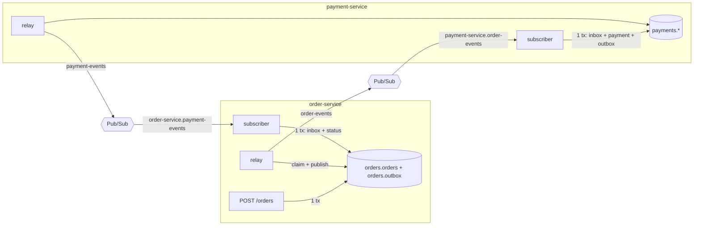
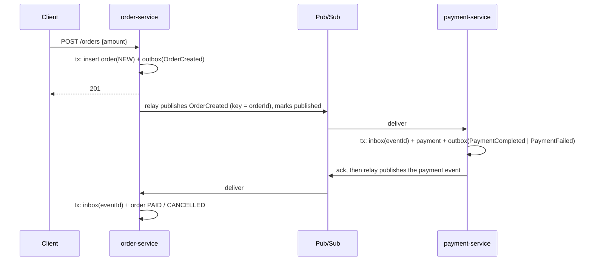

# Spring Pub/Sub Transactional Outbox PoC

Two Spring Boot 4.1 services (Kotlin, JDK 25) exchange events over GCP Pub/Sub. They use a **transactional outbox** to publish and an **idempotent inbox** to consume. Everything runs on the Pub/Sub emulator first, then on GCP (Cloud Run + Cloud SQL).

What it shows:

- The business row and the outbox row commit atomically.
- Delivery is at least once.
- Events are ordered per aggregate, even with several relay instances.
- The inbox makes consumers exactly-once in effect.
- A poison event surfaces in metrics and an alert.
- Failure demos you can run.

## Architecture





- **Modules:** `outbox-lib` (outbox, relay, inbox, subscriber, metrics, auto-config), `order-service` (:8081), `payment-service` (:8082), `e2e-tests`.
- **Payment rule:** an amount ≤ 1000 is approved. Anything higher is declined with "amount exceeds limit".
- **Messages:** JSON body. Attributes `eventId`, `eventType`, `aggregateId`, `occurredAt`, `traceparent`. The ordering key is the orderId.
- **Relay** (`OutboxRelay`, every 500 ms, batch 100), all in one transaction:
  1. Lock keys with `pg_try_advisory_xact_lock(hashtext(aggregate_id))`, skipping keys whose earliest unpublished row is failed or backing off.
  2. In a second statement, so its snapshot sees everything committed before the locks, claim those keys' rows `FOR UPDATE SKIP LOCKED`.
  3. Publish, wait for the futures and mark each row published.
  4. A failure moves the row into backoff (`min(2^attempts, 60)` s). The key's later rows are skipped and the key is `resume`d next cycle.
  5. After 10 attempts the row gets `failed_at` and blocks its key until it is requeued (see the runbook).
- **Inbox:** `insert into inbox … on conflict do nothing` runs in the same transaction as the handler and its outbox writes. The message is acked after commit and nacked on an exception.
  - An unknown `eventType` is acked and ignored.
  - A bad payload is nacked and ends up in the DLQ after 5 attempts.
- **Subscriptions:** ordering on, DLQ `<topic>-dlq` after 5 attempts, retry backoff 10–600 s. A subscriber that dies (for example on NOT_FOUND) resubscribes after 5 s.
- **Housekeeping:** published outbox rows are purged after 7 days and inbox rows after 14 days (hourly).

## Run locally

Prerequisites: JDK 25, Docker.

```bash
./gradlew build                # all tests; Testcontainers starts Postgres 18 and the emulator
./gradlew jibDockerBuild       # local/order-service, local/payment-service
docker compose --profile apps up -d --scale order-service=2
```

If host port 5432 is taken, prefix compose commands with `POSTGRES_PORT=5433` (the apps use the compose network either way).

Order replicas get host ports from the range 8081–8083 and the assignment varies, so look up each one:

```bash
ORDER=$(docker compose port --index 1 order-service 8081)   # e.g. 127.0.0.1:8081
ID=$(curl -s -XPOST $ORDER/orders -H 'content-type: application/json' -d '{"amount":50}' | jq -r .id)
curl -s $ORDER/orders/$ID        # PAID within a few seconds; amount 5000 -> CANCELLED
curl -s -XPOST $ORDER/orders/$ID/cancel   # 409 unless NEW
```

Grafana (traces, metrics, logs) runs at http://localhost:3000 (admin/admin). Useful metrics:
- `outbox_pending`, `outbox_lag_seconds`, `outbox_failed`, `outbox_blocked`
- `outbox_published_total`, `outbox_publish_failures_total`
- `inbox_messages_total{outcome}`

On a fresh database, the two order replicas race to create Liquibase's tables. One of them exits, and `restart: unless-stopped` brings it back.

## Failure demos

| Demo | How | What to watch |
|---|---|---|
| Crash after publish, before commit | `POC_CHAOS_CRASH_AFTER_PUBLISH=true docker compose --profile apps up -d order-service`, create an order, watch the container exit, then `docker compose --profile apps up -d order-service` (flag off; with it on, every restart crashes again) | The JVM halted after publishing, so the row was not marked. On restart it is published again and the payment inbox logs `Duplicate eventId … skipped`. Exactly one payment. |
| Flaky consumer | `POC_CHAOS_CONSUMER_FAIL_RATE=0.5 docker compose --profile apps up -d payment-service`, then create orders | `inbox_messages_total{outcome="chaos"}` grows. Every order still ends PAID. |
| Pub/Sub outage | `docker compose stop pubsub`, then create an order. Check `select attempts, last_error from orders.outbox`. Then `docker compose start pubsub && docker compose run --rm pubsub-init` (the emulator is in-memory) | Attempts and backoff grow while it is down. The order becomes PAID after the restart. |
| Multiple relays | `--scale order-service=2` (above), then create many orders | Each event is published once and in order per key, thanks to the advisory locks. |

The same scenarios run automatically in `e2e-tests` (`FailureDemoTest`, `OrderPaymentFlowTest`). `OutboxRelayConcurrencyTest` checks per-key ordering with two relays.

## Poison-event runbook

Symptom: the `Outbox failed events` alert fires (`outbox_failed > 0`), or an `ERROR … Outbox event failed permanently` log appears. The row's aggregate is blocked, and `outbox_blocked` counts the events waiting behind it.

1. Find the row:
   ```sql
   select id, event_id, aggregate_id, topic, event_type, attempts, last_error, failed_at
   from orders.outbox where failed_at is not null;   -- or payments.outbox
   ```
2. Fix the cause, for example a missing topic, an IAM permission or an oversized payload.
3. Requeue the row. The relay publishes it, then the blocked rows behind it, in order:
   ```sql
   update orders.outbox set failed_at = null, attempts = 0, next_attempt_at = null where event_id = '<event_id>';
   ```

## GCP

Terraform in `infra/terraform` creates:
- the APIs and an Artifact Registry repo `poc`
- topics, DLQs, subscriptions and the DLQ `.inspect` subscriptions
- service accounts `order-svc` and `payment-svc` with least-privilege roles
- Cloud SQL Postgres 18 (`db-f1-micro`, IAM auth)
- Cloud Run v2 services: min 1 instance, CPU always on, payment internal-only, no public invoker
- an `otelcol-google` sidecar per service that sends traces to Cloud Trace and metrics to Managed Prometheus
- an email alert on `outbox_failed > 0`

The apps run with profile `gcp`. They connect through the Cloud SQL Java connector with IAM auth and use the real Pub/Sub.

```bash
gcloud auth login && gcloud auth application-default login
cd infra/terraform
cat > terraform.tfvars <<EOT
project_id  = "<project>"
alert_email = "<you@example.com>"
EOT
terraform init
terraform apply -target=google_project_service.apis -target=google_artifact_registry_repository.poc
gcloud auth configure-docker europe-west1-docker.pkg.dev
(cd ../.. && IMAGE_REPO=$(terraform -chdir=infra/terraform output -raw image_repo) ./gradlew jib)
terraform apply \
  -var order_image=$(terraform output -raw image_repo)/order-service \
  -var payment_image=$(terraform output -raw image_repo)/payment-service
```

Then, once:
1. Open Cloud SQL Studio for `poc-pg`, database `poc`. Sign in as `postgres` (`terraform output -raw postgres_password`).
2. Run `infra/sql/bootstrap.sql` with `<project>` replaced. This creates the schemas owned by the IAM users.
3. Restart both services: `gcloud run services update order-service --region europe-west1 --update-env-vars RESTART=$(date +%s)` (same for payment-service).

Smoke test:

```bash
URL=$(terraform output -raw order_url)
curl -H "Authorization: Bearer $(gcloud auth print-identity-token)" -XPOST $URL/orders \
  -H 'content-type: application/json' -d '{"amount":50}'
```

To see dead letters, pull from `gcloud pubsub subscriptions pull order-events-dlq.inspect --auto-ack`. To produce one, redeploy payment with `POC_CHAOS_CONSUMER_FAIL_RATE=1.0`.

Results of the GCP run are recorded below once it has been done.

## Known limits

- A failed row blocks its aggregate until someone requeues it. This is deliberate, to keep ordering.
- The emulator may not apply dead-letter policies, so DLQ behaviour is only checked on GCP. The emulator is in-memory: after a restart, re-run `pubsub-init`.
- The relay polls. There is no LISTEN/NOTIFY or CDC. Batch claims hold row locks while publishing, which can take up to 30 s on an outage.
- The relay waits for publish futures inside the database transaction. That is fine at PoC volume, but it holds a connection per relay instance.
